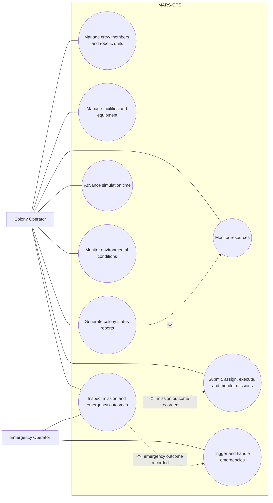

# Use Case Diagram

The report includes colony resource totals. Mission execution progresses as simulation time advances, but submitting a mission does not itself include a separate time-advancement use case. Outcome inspection is an optional follow-up to mission or emergency handling; the Java status report exposes the corresponding histories.
